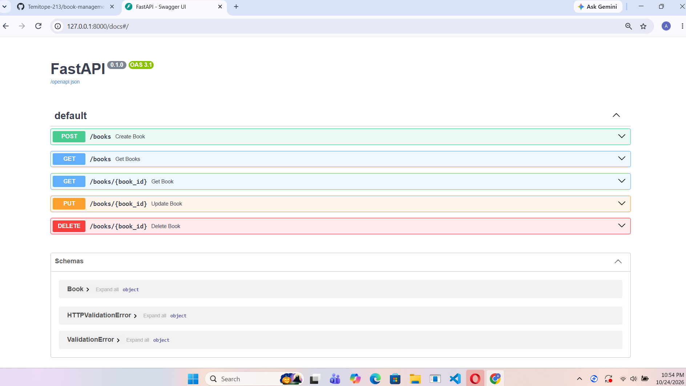
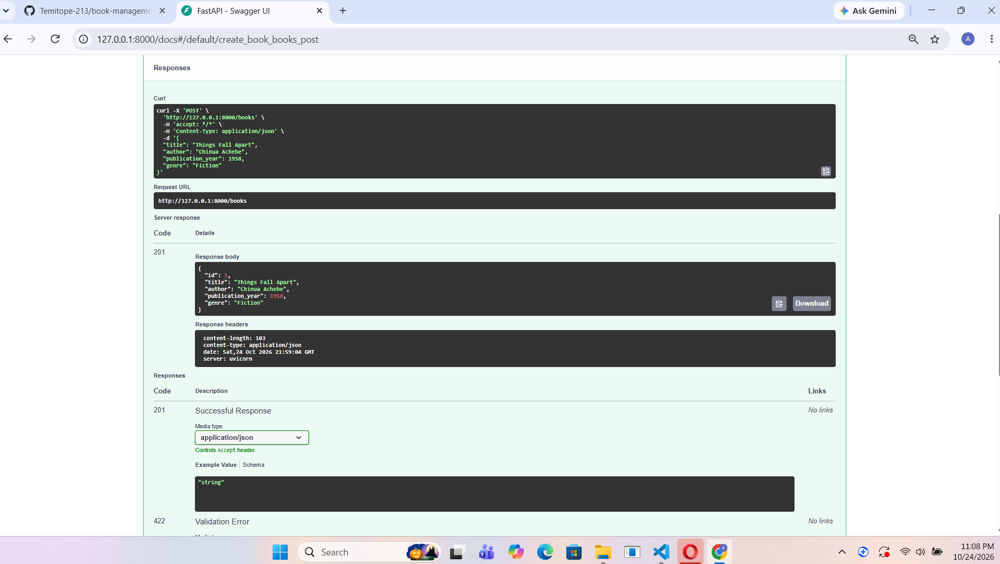
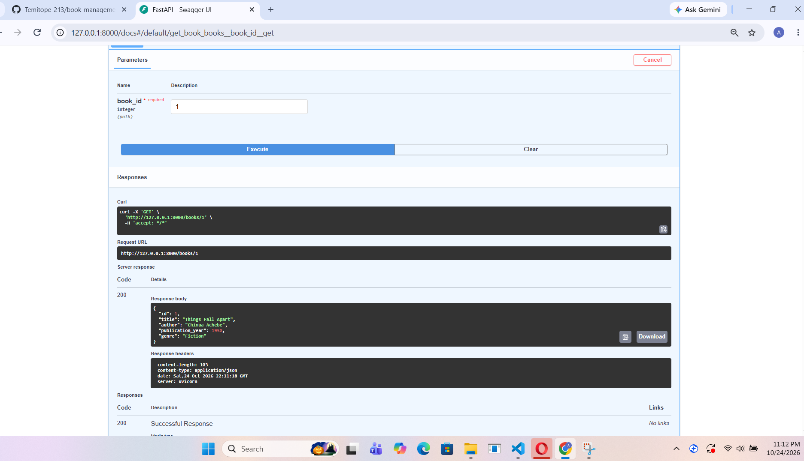
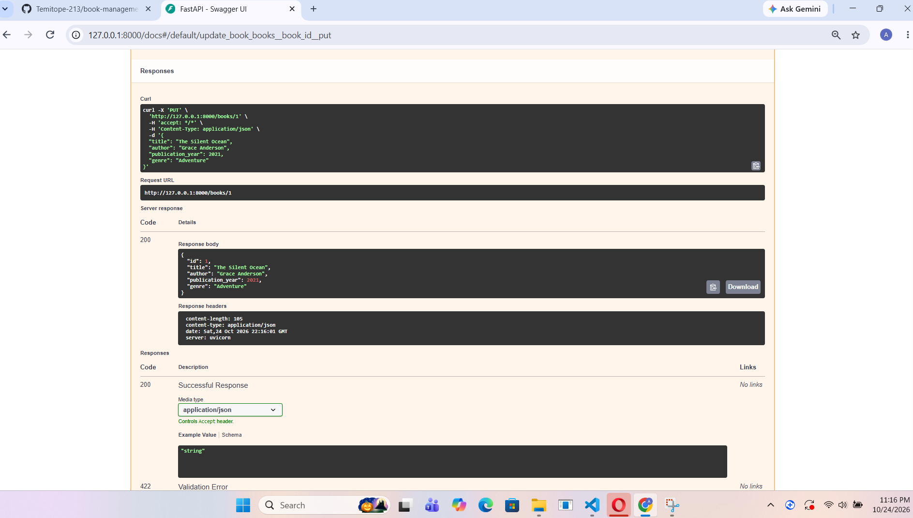
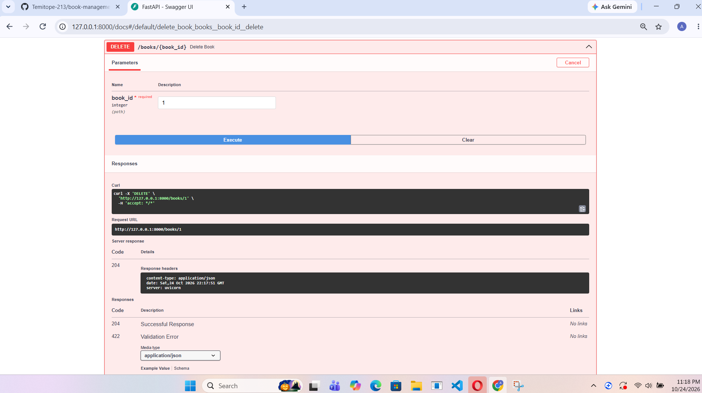
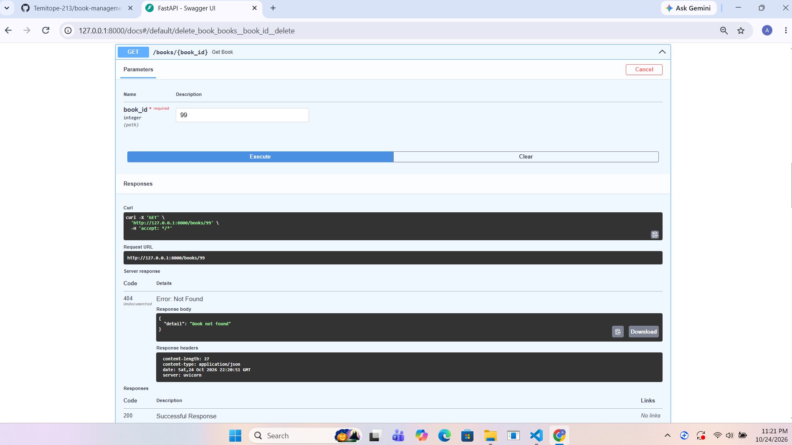

# Book Management API

## Project Description
The Book Management API is a REST API built with Python and FastAPI. It lets users add, view, update, and delete books. Each book has a title, author, publication year, and genre. The API validates incoming data with Pydantic, filters books by genres, and returns a 404 error when a a requested book doesn't exist. Books are stored in memory, so they are cleared whenever the server restarts.

## Features
- POST /books: add a new book
- GET /books: list all books (filter with '?genre=Fiction', limit with '?limit=2')
- GET /books/{book_id}: get one book by ID
- PUT /books/{book_id}: update a book
- DELETE /books/{book_id}: delete a book
- Automatic ID generation for each new book
- Data validation with Pydantic
- Error handling: returns 404 if a book is not found

Example request body for POST and PUT:
'''json
{
    "title": "Things Fall Apart",
    "author": "Chinua Achebe",
    "publication_year": 1958,
    "genre": "Fiction"
}
'''

## Technologies Used 
- Python
- FastAPI
- Uvicorn
- Pydantic

## Dependencies
- fastapi
- uvicorn

Install them with:

'''
pip install -r requirements.txt
'''

# Installation and Setup
1. Clone the repository:
'git clone https://github.com/Temitope-213/book-management-api.git'
2. Go into the folder: 'cd book-management-api'
3. Create a virtual environment: 'python -m venv .venv'
4. Activate it (Windows): 'venv\Scripts\Activate.ps1'
5. Install dependencies: 'pip install -r requirements.txt'

## How to Run the Project
Start the server with:
'python -m uvicorn main:app --reload'

The API runs at http://127.0.0.1:8000. Press 'Ctrl + C' in the terminal to stop it.

## API Documentation and Screenshots
FastAPI creates interactive documentation automatically. With the server running, open http://127.0.0.1:8000/docs in your browser to view and test every endpoint.

### API docs 

### Create a book

### Get a book

### Update a book

### Delete a book

### Book not found(404)
